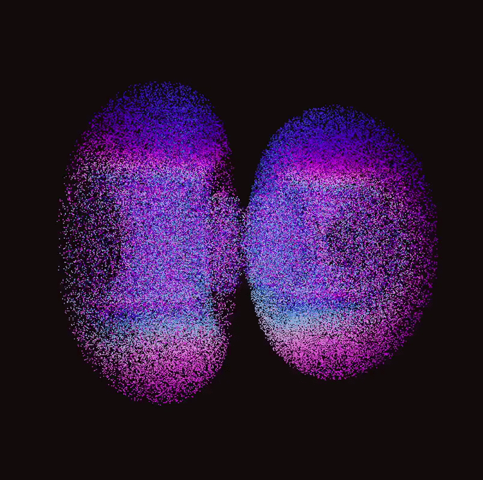

A hydrogen orbital probability visualiser written in c++ with opengl.
[See Derivations (unfinished)](./derivations/derivation.pdf)



To compile

```
git clone https://github.com/leoburgesss/Hydrogen-orbitals.git
cd Hydrogen-Orbitals
nix develop
cmake -S . -B build
cmake --build build
```


To run
```
./build/hydrogen {n} {l} {m}
```


(Demo gif is n=4 l=2 m=1)
